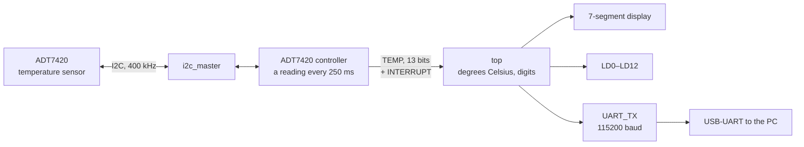

# Nexys 4 DDR temperature monitor

A VHDL design for the Digilent Nexys 4 DDR (Xilinx Artix-7 XC7A100T) that reads the board's ADT7420 temperature sensor over I2C, shows the temperature in degrees Celsius on the 7-segment display and the raw reading on the LEDs, and sends each reading over the USB-UART. A fourth-year engineering project (Projet 4A), built with Vivado 2024.1.

- ADT7420 read over I2C at 400 kHz every 250 ms, in its 13-bit mode (0.0625 °C a step).
- The temperature in whole degrees on the 7-segment display: three digits and a minus sign, multiplexed at 1 kHz.
- The raw 13-bit reading on LD0–LD12.
- Each reading sent on the USB-UART at 115200 baud, 8N1.

## Design



| File | Role |
|---|---|
| [top.vhd](project_4A_VER.srcs/sources_1/new/top.vhd) | Top level: the ADT7420 controller and the UART transmitter, the conversion to degrees Celsius, the 7-segment display and the LEDs |
| [ADT7420.vhd](project_4A_VER.srcs/sources_1/new/ADT7420.vhd) | Reads the temperature register every 250 ms through the I2C master, and pulses `INTERRUPT` with each new 13-bit reading |
| [i2c_master.vhd](project_4A_VER.srcs/sources_1/new/i2c_master.vhd) | I2C master |
| [UART_TX.vhd](project_4A_VER.srcs/sources_1/new/UART_TX.vhd) | UART transmitter |
| [nexys4ddr_master.xdc](project_4A_VER.srcs/sources_1/new/nexys4ddr_master.xdc) | Pin constraints |
| [TempConverter.vhd](project_4A_VER.srcs/sources_1/new/TempConverter.vhd), [sevensegment_ex01.vhd](project_4A_VER.srcs/sources_1/new/sevensegment_ex01.vhd) | Earlier stand-alone versions of the conversion and of the display, now part of `top.vhd`; in the project but not used by the top level |

The ADT7420 gives the temperature as a 13-bit two's complement number in steps of 0.0625 °C. `top.vhd` turns it into whole degrees as `raw * 625 / 10000`, then into the digits the display multiplexes.

## Inputs and outputs

| Signal | On the Nexys 4 DDR | Pin |
|---|---|---|
| `CLK` | 100 MHz oscillator | E3 |
| `RST_N` | Switch SW0: up to read the sensor, down to hold the ADT7420 controller in reset | J15 |
| `SCL`, `SDA` | ADT7420 | C14, C15 |
| `TX` | USB-UART, towards the PC | D4 |
| `LED[15:0]` | LD0–LD15: the raw reading on LD0–LD12 | see the XDC |
| `anodes`, `cathods` | 7-segment display: the four right-hand digits | see the XDC |

## UART output

As the code is written, each reading goes out as two bytes: the 13-bit value sign-extended to 16 bits, high byte first. Divided by 16, it is the temperature in degrees Celsius. With Python and pyserial:

```python
import struct
import serial

# The board's USB-UART: COMx on Windows, /dev/ttyUSB1 on Linux
with serial.Serial("/dev/ttyUSB1", 115200) as port:
    while True:
        (raw,) = struct.unpack(">h", port.read(2))
        print(f"{raw / 16:.4f} °C")
```

The pairs come 250 ms apart; open the port between two readings so that the bytes stay paired.

## Results

Implemented with Vivado 2024.1 for the XC7A100T-1CSG324:

| Resource | Used | Available |
|---|---|---|
| LUTs | 1,936 (3.1%) | 63,400 |
| Flip-flops | 188 (0.15%) | 126,800 |
| I/O | 37 (17.6%) | 210 |
| Block RAM, DSP | 0 | |

Timing is met at 100 MHz with a worst negative slack of +5.42 ns. Vivado estimates the on-chip power at 0.143 W.

## Building and programming

1. Open `project_4A_VER.xpr` in Vivado 2024.1 or later.
2. Generate the bitstream, then program the board from the Hardware Manager.
3. Put SW0 up.

To program the board without building, open the Hardware Manager and program [bitstream/nexys4ddr_temperature_monitor.bit](bitstream/nexys4ddr_temperature_monitor.bit), built from these sources.

## Report

[Rapport_Project4A.pdf](Rapport_Project4A.pdf) (in French) describes the I2C protocol, the acquisition, the conversion, the display, the UART transmission and the technical challenges.

## Credits

- `UART_TX.vhd` is by Mehmet Burak Aykenar.
- `i2c_master.vhd` is based on the I2C master published by Digi-Key (Scott Larson), with usage notes by Mehmet Burak Aykenar.
- `ADT7420.vhd` is based on an ADT7420 example by Mehmet Burak Aykenar.
